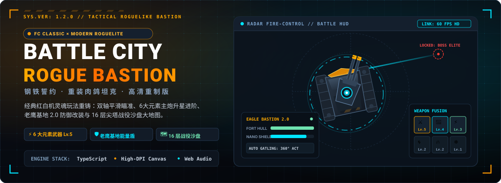
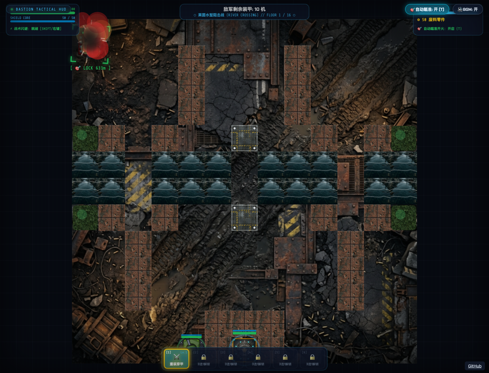

<p align="right"><a href="README.md">中文</a></p>

<p align="center">
  
</p>

<p align="center">
  <a href="https://battle-city-roguelike.xiaosang.cc/">▶ Play Online</a>
  ·
  <a href="https://github.com/holynova/battle-city-roguelike">GitHub Repository</a>
</p>

A Battle City × roguelite remake in HD: drive a tank to defend the Eagle base with independent chassis and turret control, climb a 16-floor campaign map, unlock 6 elemental cannons and 26 upgrades, and face the final boss "Goliath" on floor 16. TypeScript + Vite + Canvas, high-DPI rendering, procedural Web Audio sound.

## Screenshot

<p align="center">
  
</p>

## How to Play

- **Dual-axis control**: WASD / arrow keys drive the chassis, the mouse aims the turret through 360°, left-click or Space fires; Shift / F / Q dash (with i-frames, so you can pass through bullet patterns); T toggles auto-aim.
- **Defend the Eagle base**: the base has its own shield (50) and armor — no more one-shot losses like the FC original — plus defensive modules like point-defense gatling and nano-shield.
- **6 elemental cannons**: kinetic AP, prism laser, Tesla ball lightning, gale singularity, napalm mortar, cryo nova; switch with keys 1–6 or the scroll wheel, and stack upgrades across the run.
- **26 upgrades**: high-velocity rounds, reinforced armor, twin barrels, bouncing shells, vampiric scavenger, hover chassis, steel-core AP rounds and more — freely combinable builds.
- **16-floor campaign map**: 39 nodes of battles, elites, events, shops, rest sites, and boss fights on branching paths; the floor-16 finale is the land cruiser 「歌利亚」 ("Goliath"), with three-phase full-screen bullet patterns, sweeping lasers, and heavy artillery.

## Run Locally

```bash
npm ci
npm run dev        # dev server
npm run build      # production build
```

## Tech

- TypeScript + Vite, high-DPI Canvas rendering (crisp edges at 1080p / 2K / 4K / Retina).
- Fully procedural Web Audio sound and music: zero external audio assets — gunfire, treads, EMP, and alarms are all synthesized in code.
- Particles and impact: muzzle flashes light up the terrain, 3D brick shards, tread marks, explosion shockwaves, and subtle screen shake.

```
src/core/Engine.ts      Game loop, input, tick, bullet time
src/entities/           Player / enemies / elites / boss / Eagle base / projectiles / drops
src/map/TileMap.ts      Brick / steel / river / forest terrain
src/graphics/           HD vector rendering, particles, tactical icons
src/roguelite/          Campaign map, 26 upgrades, loot inventory
src/ui/                 HUD, tactical overlays (level select / upgrades / shop / results)
src/audio/              Procedural sound and music engine
public/assets/images/   Title art, card portraits, boss portrait, terrain tiles
```

## License

MIT, see `LICENSE`.
