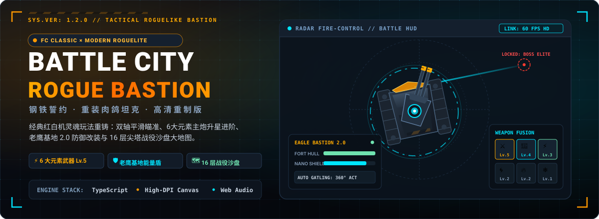
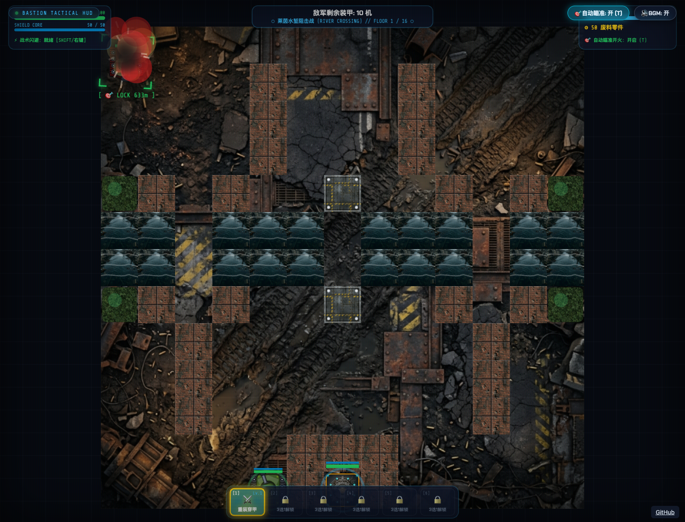

<p align="right"><a href="README.en.md">English</a></p>

<p align="center">
  
</p>

<p align="center">
  <a href="https://battle-city-roguelike.xiaosang.cc/">▶ 在线玩</a>
  ·
  <a href="https://github.com/holynova/battle-city-roguelike">GitHub 仓库</a>
</p>

FC 经典《坦克大战》× Roguelike 的高清重制版：驾驶坦克守卫老鹰基地，底盘与炮塔双轴独立控制，在 16 层尖塔战役地图上推进，解锁 6 种元素主炮、收集 26 种改装与武器强化，最终挑战第 16 层的终局 Boss「歌利亚」。TypeScript + Vite + Canvas，高 DPI 渲染，Web Audio 程序化音效。

## 截图

<p align="center">
  
</p>

## 玩法

- **双轴控制**：WASD / 方向键驾驶底盘，鼠标 360° 瞄准炮塔，左键或空格开火；Shift / F / Q 冲刺（带无敌帧，可穿弹幕）；T 开关自动瞄准。
- **守卫老鹰基地**：基地有独立护盾（50 点）与装甲，不再是 FC 版"一发冷枪秒杀"；可加装近防加特林、纳米护盾等防御模块。
- **6 种元素主炮**：动能穿甲炮、棱镜激光、特斯拉球状闪电、飓风奇点炮、凝固汽油迫击炮、冷冻新星；数字键 1–6 或滚轮切换，武器可随战役升级叠层。
- **26 种强化**：高速弹、强化装甲、双管炮、弹跳弹、吸血清道夫、悬浮底盘、钢芯破甲弹等，自由联动构筑。
- **16 层战役地图**：39 个节点，遭遇战、精英战、事件、商店、休整营地与 Boss 战分支推进；第 16 层终局决战：陆上巡洋舰「歌利亚」，三阶全域弹幕、扫射激光与全屏重炮。

## 本地运行

```bash
npm ci
npm run dev        # 开发服务器
npm run build      # 生成生产产物
```

## 技术

- TypeScript + Vite，Canvas 高 DPI 渲染（1080P / 2K / 4K / Retina 均保持锐利边缘）。
- 程序化 Web Audio 音效与音乐：零外部音频依赖，炮击、履带、EMP、警报全部代码合成。
- 粒子与打击感：炮口闪光照亮地形、碎砖 3D 破片、履带压痕、爆炸冲击波与屏幕微震。

```
src/core/Engine.ts      游戏主循环、输入、Tick、子弹时间
src/entities/           玩家 / 敌军 / 精英 / Boss / 老鹰基地 / 弹道 / 掉落
src/map/TileMap.ts      砖墙 / 钢墙 / 河流 / 森林等地形
src/graphics/           HD 矢量渲染、粒子特效、战术图标
src/roguelite/          战役地图、26 种强化、战利品库存
src/ui/                 HUD、战术覆盖层（选关 / 强化 / 商店 / 结算）
src/audio/              程序化音效与音乐引擎
public/assets/images/   标题图、卡牌立绘、Boss 肖像、地形贴图
```

## 许可

MIT，见 `LICENSE`。
